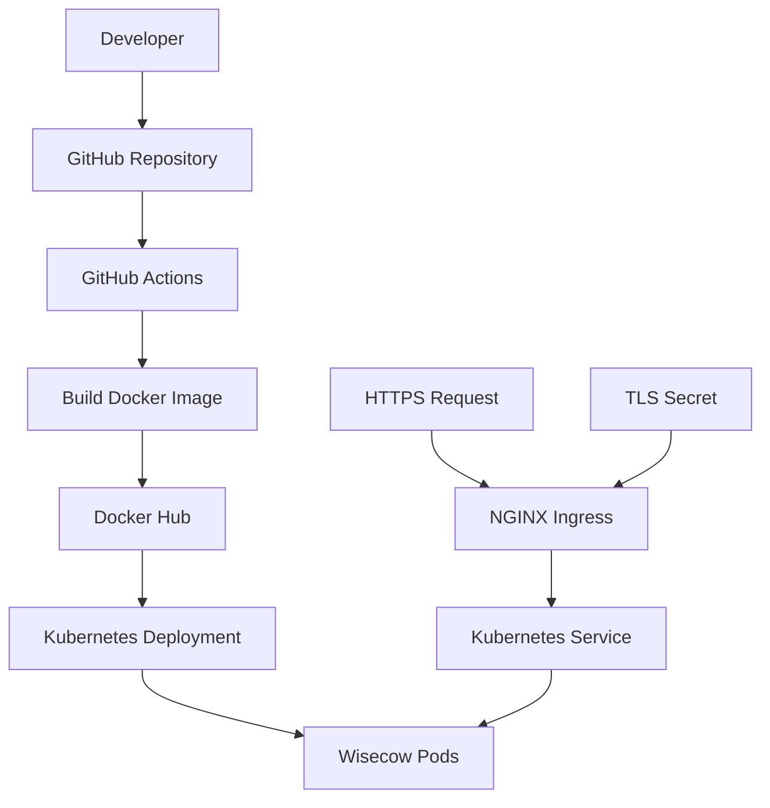
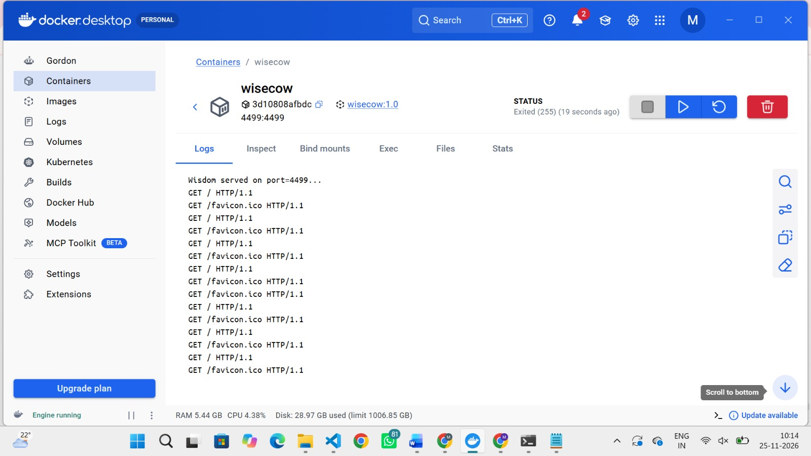
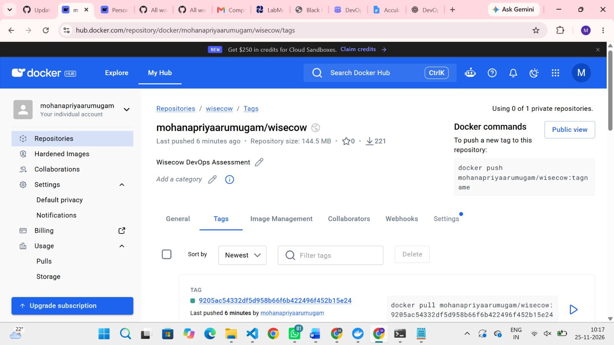
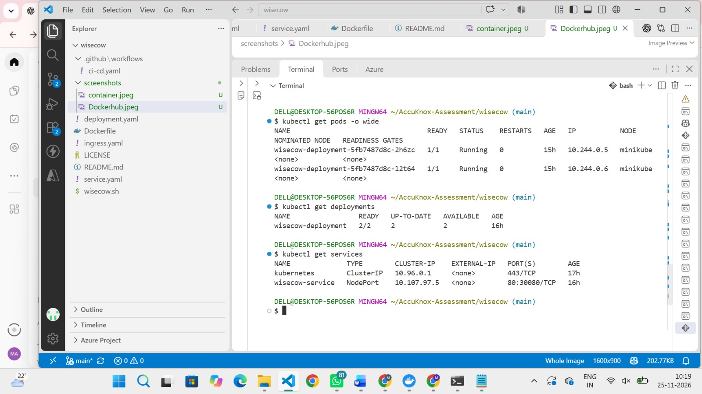
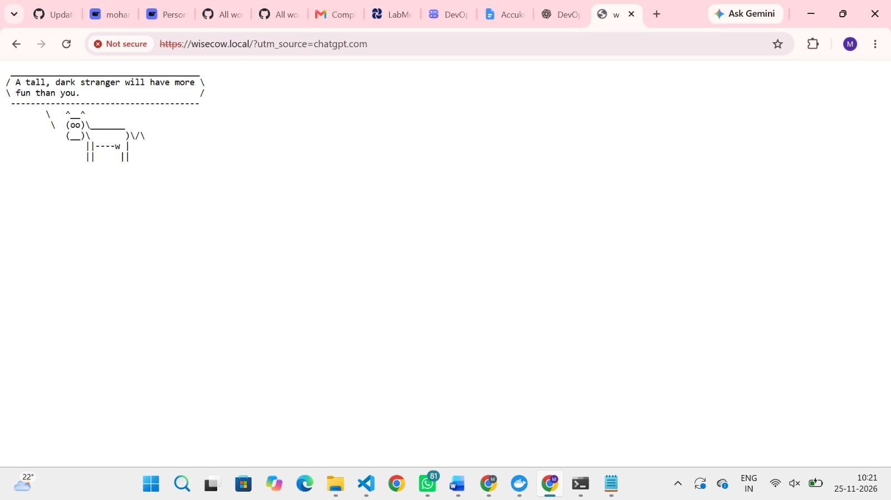
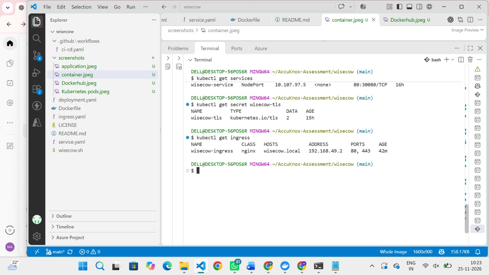
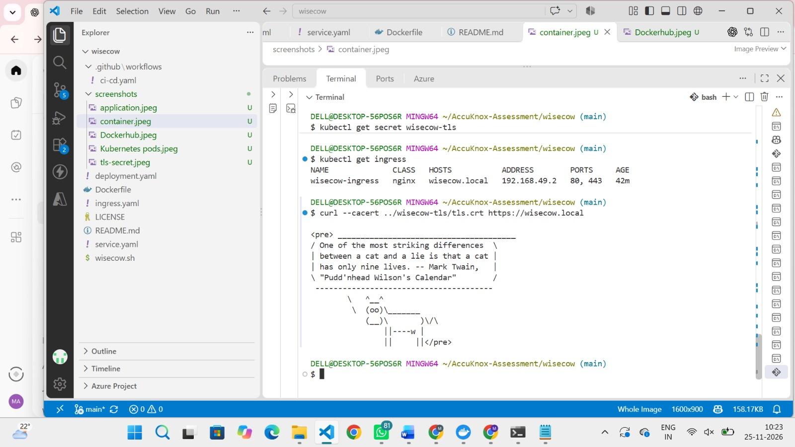
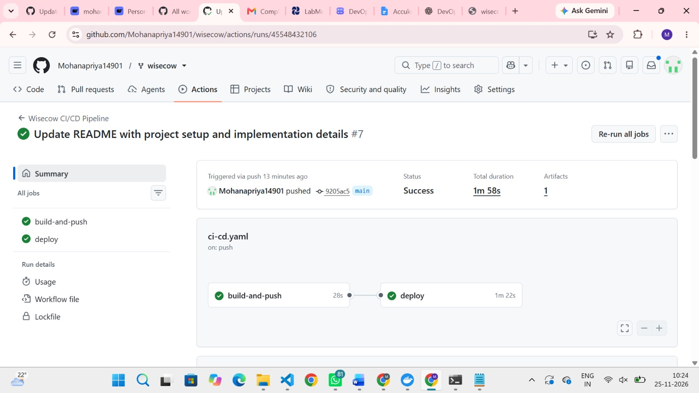

# Wisecow – Docker, Kubernetes and CI/CD

## About the Project

This project was developed as part of the AccuKnox DevOps assessment.

Wisecow is a simple web application that displays random fortunes using
fortune-mod and cowsay. The original application runs as a shell script
on port 4499.

The main goal of this project was to containerize the application,
deploy it on Kubernetes, automate the build and deployment process
using GitHub Actions, and enable HTTPS using TLS.

## Tools and Technologies

- Docker – Containerizing the application
- Docker Hub – Storing Docker images
- Kubernetes – Managing application deployment
- Minikube – Local Kubernetes environment
- Kind – Kubernetes environment for GitHub Actions
- GitHub Actions – CI/CD automation
- NGINX Ingress – Routing application traffic
- OpenSSL – Generating TLS certificates
- Bash – Shell scripting

## Project Structure

```text
wisecow/
├── .github/
│   └── workflows/
│       └── ci-cd.yaml
├── Dockerfile
├── deployment.yaml
├── service.yaml
├── ingress.yaml
├── wisecow.sh
├── LICENSE
└── README.md
```

## Architecture



## Prerequisites

Before running the project, make sure the following tools are installed:

- Docker
- Minikube
- kubectl
- Git
- OpenSSL

## 1. Running the Application Without Docker

Install the required packages on Ubuntu:

```bash
sudo apt install fortune-mod cowsay -y
```

Run the shell script:

```bash
chmod +x wisecow.sh
./wisecow.sh
```

Open http://localhost:4499 in your browser to view the application.

## 2. Running the Application Using Docker

I created a Dockerfile to package the application along with its
dependencies so that it can run without manually installing them
on the host machine.

Build the image:

```bash
docker build -t wisecow:latest .
```

Run the container:

```bash
docker run --rm -p 4499:4499 wisecow:latest
```

Open http://localhost:4499 in your browser.

The Docker image is also available on Docker Hub:

```bash
docker pull mohanapriyaarumugam/wisecow:latest
```

## 3. Deploying on Kubernetes

I used Minikube to set up and test the application locally.

Start Minikube:

```bash
minikube start
```

Apply the Kubernetes manifests:

```bash
kubectl apply -f deployment.yaml
kubectl apply -f service.yaml
```

The deployment runs two replicas of the Wisecow application.
A NodePort service is used to expose the application.

Check whether the resources are running:

```bash
kubectl get pods
kubectl get deployments
kubectl get services
```

Access the application using:

```bash
minikube service wisecow-service --url
```

## 4. CI/CD Pipeline Using GitHub Actions

I configured GitHub Actions to automate the Docker image build,
image push, Kubernetes deployment and application testing.

The workflow is triggered whenever changes are pushed to the
main branch. It can also be triggered manually.

The pipeline consists of two jobs.

### Build and Push

- Checkout the source code.
- Log in to Docker Hub.
- Build the Docker image.
- Push the image to Docker Hub.

### Deploy and Verify

- Create a temporary Kind Kubernetes cluster.
- Install the NGINX Ingress Controller.
- Generate a self-signed TLS certificate.
- Create a Kubernetes TLS secret.
- Deploy the Wisecow application.
- Check deployment readiness.
- Configure Ingress.
- Test the application over HTTPS.
- Clean up temporary certificate files.

The deployment job starts only after the build-and-push job
completes successfully.

### GitHub Actions Secrets

I used GitHub Actions secrets to avoid exposing Docker Hub
credentials directly in the workflow file.

| Secret | Description |
|--------|-------------|
| DOCKER_USERNAME | Docker Hub username |
| DOCKER_TOKEN | Docker Hub access token |

## 5. Enabling TLS and HTTPS

As part of the challenge requirement, I configured NGINX Ingress
and a self-signed TLS certificate to enable HTTPS communication.

### Enable Ingress

```bash
minikube addons enable ingress
```

Check the Ingress Controller:

```bash
kubectl get pods -n ingress-nginx
```

### Generate the TLS Certificate

Create a directory outside the project repository:

```bash
mkdir -p ../wisecow-tls
```

Generate the certificate and private key:

```bash
openssl req -x509 -nodes -days 365 \
  -newkey rsa:2048 \
  -keyout ../wisecow-tls/tls.key \
  -out ../wisecow-tls/tls.crt \
  -subj "/CN=wisecow.local" \
  -addext "subjectAltName=DNS:wisecow.local"
```

When running this command in Windows Git Bash, use
`MSYS_NO_PATHCONV=1` before the command if required.

### Create the Kubernetes TLS Secret

```bash
kubectl create secret tls wisecow-tls \
  --cert=../wisecow-tls/tls.crt \
  --key=../wisecow-tls/tls.key
```

### Apply the Ingress Manifest

```bash
kubectl apply -f ingress.yaml
kubectl get ingress
```

### Configure Local Access

For my Windows Minikube setup, I added the following entry
to the Windows hosts file:

```text
127.0.0.1 wisecow.local
```

The hosts file is located at:

```text
C:\Windows\System32\drivers\etc\hosts
```

Administrator permissions are required to modify this file.

Start the Minikube tunnel in a separate terminal:

```bash
minikube tunnel
```

Keep this terminal running while accessing the application.

### Verify HTTPS

```bash
curl --cacert ../wisecow-tls/tls.crt https://wisecow.local
```

The application should return a random fortune along with
the ASCII cow output.

Since I used a self-signed certificate, the browser may show
a certificate trust warning. I verified the HTTPS connection
using curl with the generated certificate.

The TLS private key is stored outside the Git repository
and should not be committed.

## 6. Challenges Faced

While working on this project, I encountered a few issues:

- Docker Hub authentication initially failed because of an
  incorrect GitHub Actions secret reference. I corrected the
  reference and successfully pushed the Docker image.

- OpenSSL was not recognized in the Windows Command Prompt.
  I resolved this by using Git Bash.

- Accessing the application through Ingress on Windows
  required a Minikube tunnel and a local hosts file entry.

- The HTTPS request in GitHub Actions initially failed because
  port forwarding was not ready. The retry mechanism allowed
  the request to succeed once the connection became available.

Working through these issues helped me better understand
Docker authentication, Kubernetes networking, Ingress,
TLS certificates and CI/CD troubleshooting.

## 7. Testing and Results

The following features were successfully tested:

- Docker image build and push to Docker Hub.
- Kubernetes deployment with two replicas.
- Application access through the Kubernetes service.
- NGINX Ingress configuration.
- TLS certificate and secret creation.
- Local HTTPS access using curl.
- Automated deployment and HTTPS testing in GitHub Actions.

Both the build-and-push and deployment jobs completed successfully.

## 8. Current Limitations

The GitHub Actions pipeline creates a temporary Kind cluster
for deployment testing rather than deploying to a permanent
production environment.

The TLS certificate is self-signed and is intended for
local development and assessment purposes.

For a production environment, I would use a persistent
Kubernetes cluster and a trusted TLS certificate.

## Implementation Screenshots

### Docker Container


### Docker Hub Image


### Kubernetes Deployment


### Wisecow Application


### TLS Secret Configuration


### HTTPS Verification


### Successful CI/CD Pipeline


## Conclusion

Through this project, I gained hands-on experience with
containerization, Kubernetes deployment, CI/CD automation
and secure application communication.

I was able to deploy the Wisecow application locally and
automate the build, deployment and HTTPS verification
process using GitHub Actions.

## Acknowledgements

Original Wisecow application:
https://github.com/nyrahul/wisecow

Completed as part of the AccuKnox DevOps assessment.

## Problem Statement 2 - Bash Scripting

As part of the assessment, I also implemented:

- System Health Monitoring Script
- Application Health Checker

[View scripts and documentation](problem-statement-2/README.md)