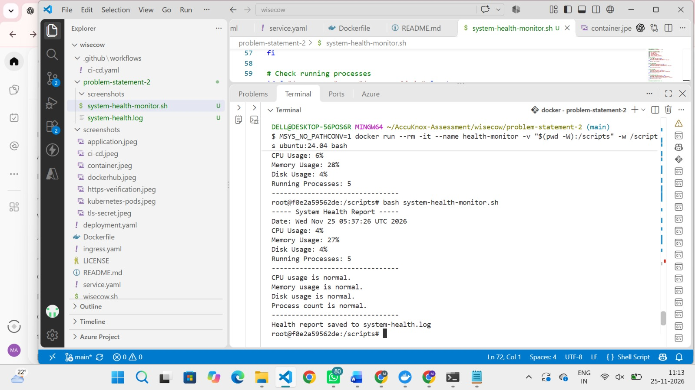
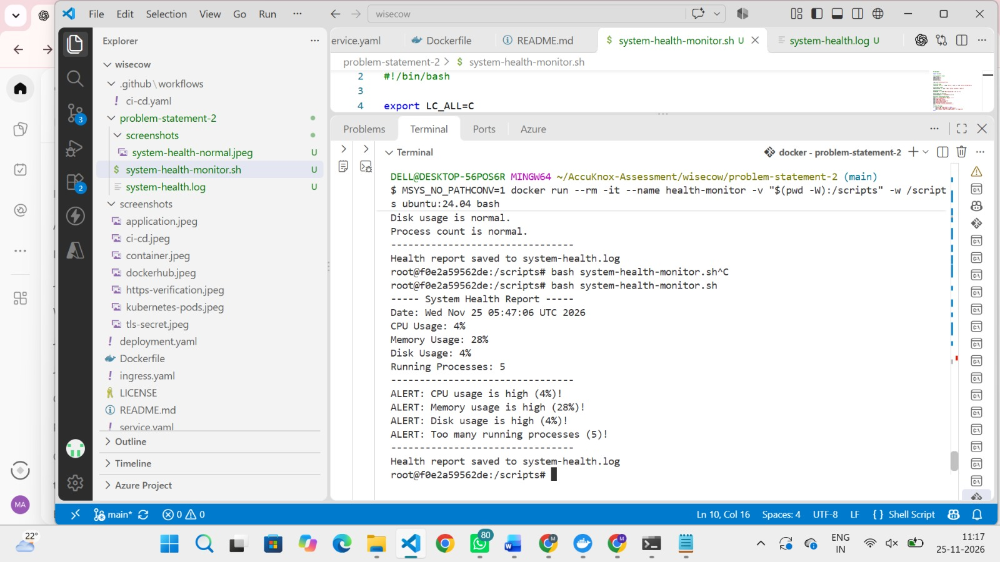
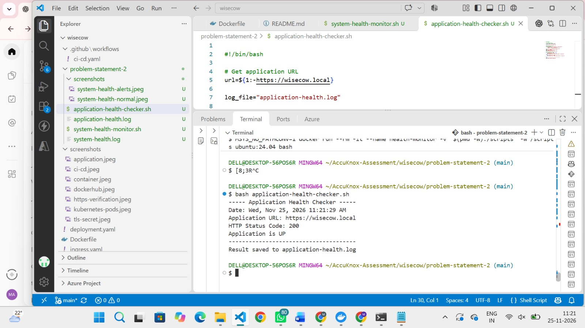
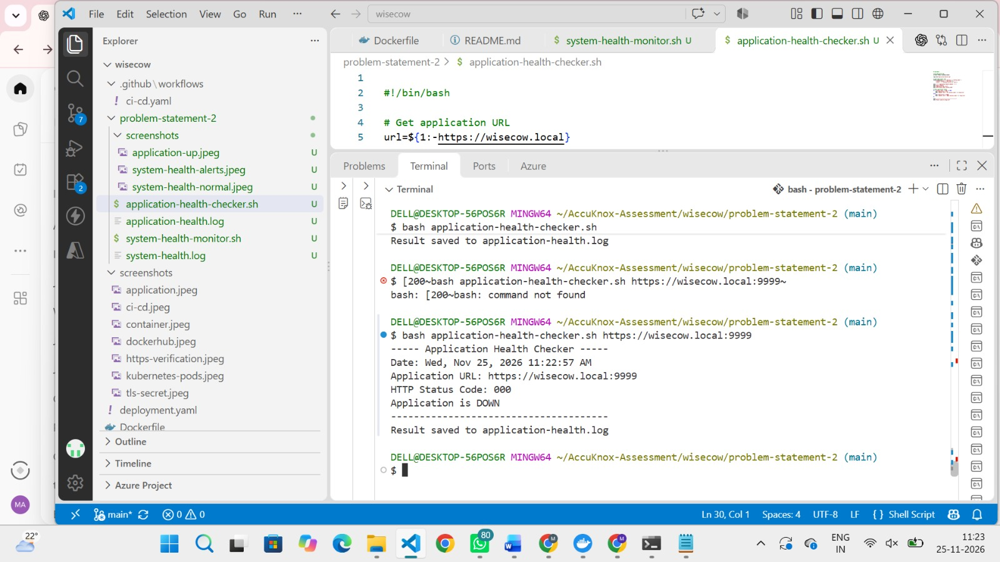

# Problem Statement 2 - Bash Scripting

## Overview

As part of the AccuKnox DevOps assessment, I selected the
following two objectives:

1. System Health Monitoring Script
2. Application Health Checker

I chose Bash because I wanted to improve my shell scripting
skills and understand how monitoring works in a Linux environment.

## 1. System Health Monitoring Script

This script checks the health of a Linux system by monitoring
CPU usage, memory usage, disk usage and running processes.

If any of these values exceed the predefined thresholds,
the script displays an alert and records it in a log file.

### Threshold Values

| Metric | Threshold |
|--------|-----------|
| CPU Usage | 80% |
| Memory Usage | 80% |
| Disk Usage | 80% |
| Process Count | 200 |

### Commands Used

- top - To check CPU usage
- free - To check memory usage
- df - To check disk usage
- ps - To check running processes
- awk - To extract required values
- echo - To display results and alerts

### How to Run

Run the following command in a Linux environment with
the required utilities installed:

```bash
bash system-health-monitor.sh
```

To view the generated log:

```bash
cat system-health.log
```

### Testing

Since I am using Windows, I used an Ubuntu 24.04 Docker
container to run and test the script in a Linux environment.

I tested the script under normal conditions and then
temporarily reduced the threshold values to check whether
the alerts were working correctly.

After testing, I restored the original threshold values.

### Normal Condition



### Alert Condition



## 2. Application Health Checker

This script checks whether an application is available
by checking its HTTP status code using curl.

I used the Wisecow application from Problem Statement 1
to test this script.

### How It Works

- Sends a request to the application URL.
- Retrieves the HTTP status code.
- Reports UP if the status code is 200.
- Reports DOWN for other status codes or connection failures.
- Saves the result with a timestamp in a log file.

### How to Run

Make sure the Wisecow application and Minikube tunnel
are running.

The script uses the TLS certificate generated during
Problem Statement 1.

Run from the problem-statement-2 directory:

```bash
bash application-health-checker.sh
```

To test an unavailable endpoint:

```bash
bash application-health-checker.sh https://wisecow.local:9999
```

To view the log:

```bash
cat application-health.log
```

### Application UP



### Application DOWN



## What I Learned

Through these two scripts, I gained practical experience in:

- Bash scripting and conditional statements.
- Linux system monitoring commands.
- Working with command outputs using awk.
- HTTP status codes and application availability.
- Generating alerts and maintaining log files.
- Testing scripts under different conditions.

## Limitations

The system monitoring script checks the metrics visible
inside the Linux environment and monitors the root filesystem.

The application health checker checks availability each
time it is executed rather than continuously monitoring
historical uptime.

The application checker uses the local Wisecow TLS certificate
for HTTPS verification.

## Conclusion

These scripts helped me understand how basic system and
application monitoring can be automated using Bash.
